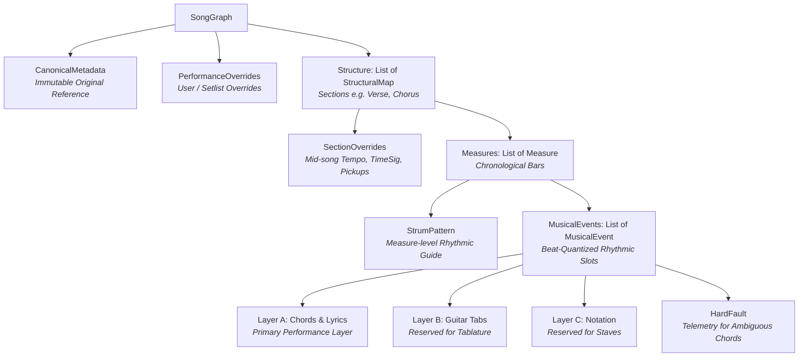
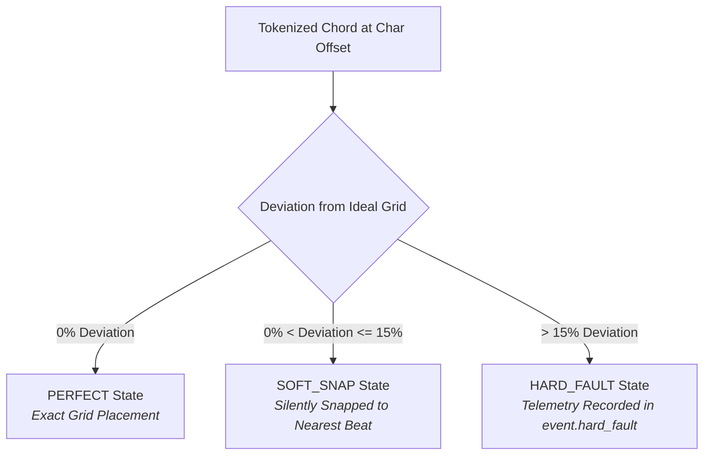
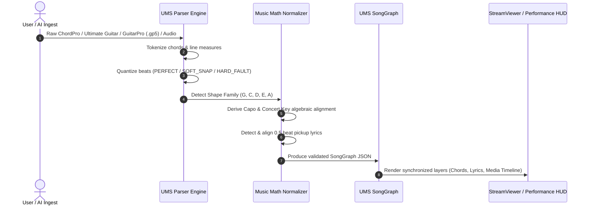

# Unified Music Schema (UMS): Complete Data & Architecture Description

The **Unified Music Schema (UMS)** is the canonical data architecture, interchange format, and domain model powering **Cadence**. It provides a single source of truth across the entire system—spanning chord/lyric parsing, rhythmic beat quantization, multi-source ingestion, real-time performance rendering, YouTube media synchronization, transposition math, and multi-user sync diffing.

The schema is maintained in Python via Pydantic models in [`ums_engine.py`](file:///home/sidell/dev/music_manager_coach/ums_engine.py) and is auto-generated into TypeScript interfaces at [`src/types/ums.ts`](file:///home/sidell/dev/music_manager_coach/src/types/ums.ts) using `json-schema-to-typescript`.

---

## 1. High-Level Entity Relationship & Hierarchy

UMS structures a song as a hierarchical **Song Graph** containing immutable original metadata, personal performance overrides, and a timeline of structural blocks divided into measures and beat-quantized musical events.

---

## 2. Core Schema Models & Field Specifications

### 2.1 Root Container: `SongGraph`

The root object representing the entire parsed musical piece.

| Field                         | Type                   | Required / Default           | Description                                                                   |
| :---------------------------- | :--------------------- | :--------------------------- | :---------------------------------------------------------------------------- |
| `canonical`                   | `CanonicalMetadata`    | **Required**                 | Immutable metadata describing the original / published version of the song.   |
| `performance`                 | `PerformanceOverrides` | Optional (`default_factory`) | Context- or user-specific overrides for personal repertoire or live sets.     |
| `structure`                   | `List[StructuralMap]`  | Optional (`[]`)              | Chronological list of logical sections (Intro, Verse, Chorus, Bridge, etc.).  |
| `requires_agent_intervention` | `boolean`              | `false`                      | Flag set to `true` if parsing encountered severe or unresolvable ambiguities. |

---

### 2.2 Metadata Layer: `CanonicalMetadata` vs. `PerformanceOverrides`

UMS separates **universal library defaults** from **player/gig-specific customizations**. If a performance override field is `null` / `undefined`, the application falls back directly to the corresponding `canonical` field.

#### `CanonicalMetadata` (Immutable Published Version)

| Field                     | Type                   | Default      | Description                                                                             |
| :------------------------ | :--------------------- | :----------- | :-------------------------------------------------------------------------------------- |
| `title`                   | `string`               | `"Untitled"` | Song title.                                                                             |
| `artist`                  | `string`               | `"Unknown"`  | Primary artist or composer.                                                             |
| `genre`                   | `string \| null`       | `null`       | Musical genre (e.g., `"Rock"`, `"Folk"`).                                               |
| `difficulty`              | `string \| null`       | `null`       | Normalized skill level (`"beginner"`, `"intermediate"`, `"advanced"`).                  |
| `original_key`            | `string`               | `"C"`        | Concert pitch key of the original recording (e.g., `"G"`, `"Eb"`, `"Am"`).              |
| `original_tempo_bpm`      | `integer`              | `120`        | Original reference tempo in Beats Per Minute (BPM).                                     |
| `original_time_signature` | `string`               | `"4/4"`      | Meter of the song (e.g., `"4/4"`, `"3/4"`, `"6/8"`).                                    |
| `original_tuning`         | `string`               | `"EADGBE"`   | Instrument tuning (e.g., `"EADGBE"`, `"Eb Ab Db Gb Bb Eb"`).                            |
| `original_capo`           | `integer`              | `0`          | Default capo fret position ($0$ = no capo).                                             |
| `original_shape`          | `string \| null`       | `null`       | Detected open-position shape family (`"G"`, `"C"`, `"D"`, `"E"`, `"A"`, `"custom"`).    |
| `chord_basis`             | `string \| null`       | `null`       | `"shape_key"` (stored as capo-relative played shapes) vs `null` (legacy concert pitch). |
| `media_url`               | `string \| null`       | `null`       | Canonical reference audio/video link (e.g., YouTube URL).                               |
| `downbeats`               | `List[float] \| null`  | `null`       | Timestamps (in seconds) of downbeats extracted via audio signal processing.             |
| `tags`                    | `List[string] \| null` | `null`       | Categorization tags (e.g., `["acoustic", "worship", "90s"]`).                           |

#### `PerformanceOverrides` (Personal / Live Gig Settings)

| Field                        | Type                   | Default | Description                                             |
| :--------------------------- | :--------------------- | :------ | :------------------------------------------------------ |
| `performance_key`            | `string \| null`       | `null`  | Key chosen by the musician (e.g. to match vocal range). |
| `performance_difficulty`     | `string \| null`       | `null`  | User-assessed difficulty rating.                        |
| `performance_tempo_bpm`      | `integer \| null`      | `null`  | Customized live performance tempo.                      |
| `performance_time_signature` | `string \| null`       | `null`  | Overridden meter.                                       |
| `performance_tuning`         | `string \| null`       | `null`  | Live instrument tuning override.                        |
| `performance_capo`           | `integer \| null`      | `null`  | Live capo placement.                                    |
| `tags`                       | `List[string] \| null` | `null`  | User-defined custom tags.                               |
| `performance_media_url`      | `string \| null`       | `null`  | User's specific backing track / practice video.         |
| `performance_downbeats`      | `List[float] \| null`  | `null`  | Performance-specific downbeat sync markers.             |

---

### 2.3 Structural Layer: `StructuralMap` & `SectionOverrides`

Each song is partitioned into logical blocks corresponding to musical sections.

#### `StructuralMap`

| Field                | Type                       | Description                                                                      |
| :------------------- | :------------------------- | :------------------------------------------------------------------------------- |
| `block_name`         | `string`                   | Display name of the block (e.g., `"Verse 1"`, `"Chorus"`, `"Bridge"`, `"Solo"`). |
| `section_overrides`  | `SectionOverrides \| null` | Section-level musical overrides (tempo shifts, meter changes, pickup markers).   |
| `measures`           | `List[Measure]`            | Chronological sequence of measures belonging to this section.                    |
| `is_locked`          | `boolean \| null`          | When `true`, protects this section from automated diff merges or AI auto-align.  |
| `sectionId`          | `string \| null`           | Slugified unique HTML/CSS-safe section ID (e.g., `"verse_1"`).                   |
| `sectionLabel`       | `string \| null`           | Human-readable section label.                                                    |
| `startBeatDivision`  | `float \| null`            | Cumulative start beat coordinate in the global rhythm timeline.                  |
| `endBeatDivision`    | `float \| null`            | Cumulative end beat coordinate in the global rhythm timeline.                    |
| `anchorPlaybackTime` | `float \| null`            | Mapped media playback timestamp (in floating-point seconds) for AV sync.         |

#### `SectionOverrides`

| Field                | Type              | Description                                                          |
| :------------------- | :---------------- | :------------------------------------------------------------------- |
| `tempo_bpm`          | `integer \| null` | Mid-song tempo changes (e.g., 140 BPM chorus in a 120 BPM song).     |
| `time_signature`     | `string \| null`  | Mid-song meter changes (e.g., 3/4 bridge in a 4/4 song).             |
| `start_time_seconds` | `float \| null`   | Direct offset timestamp for the start of the section.                |
| `has_pickup`         | `boolean \| null` | Flags whether the section begins with an anacrusis (pickup measure). |

---

### 2.4 Measure & Event Layer: `Measure`, `MusicalEvent`, and `StrumPattern`

Measures contain the discrete musical events bound to quantized rhythmic grid divisions.

#### `Measure`

| Field            | Type                   | Description                                                                           |
| :--------------- | :--------------------- | :------------------------------------------------------------------------------------ |
| `measure_index`  | `integer`              | 1-indexed global measure index across the song.                                       |
| `musical_events` | `List[MusicalEvent]`   | Chronologically sorted events occurring within this measure.                          |
| `strum_pattern`  | `StrumPattern \| null` | Rhythmic strumming guide for this measure.                                            |
| `starts_line`    | `boolean \| null`      | Visual typesetting delimiter indicating that this measure begins a new rendered line. |

#### `MusicalEvent`

| Field           | Type                       | Description                                                                                                                                  |
| :-------------- | :------------------------- | :------------------------------------------------------------------------------------------------------------------------------------------- |
| `beat_division` | `float`                    | Beat coordinate inside the measure: `1.0` (downbeat), `1.5` (eighth-note offbeat), `2.0`, `2.5`, etc. `0.5` is reserved for pickup lead-ins. |
| `layer_a`       | `Dict[str, Optional[str]]` | **Core performance layer**: `{"chord": string \| null, "lyrics": string \| null}`.                                                           |
| `layer_b`       | `Dict \| null`             | **Layer B**: Reserved for guitar tablature positions (fret/string matrices).                                                                 |
| `layer_c`       | `Dict \| null`             | **Layer C**: Reserved for standard notation staves.                                                                                          |
| `hard_fault`    | `Dict \| null`             | Ambiguous chord placement telemetry: `{"original_chord": str, "deviation": float, "error": str}`.                                            |

#### `StrumPattern`

| Field     | Type             | Description                                                                    |
| :-------- | :--------------- | :----------------------------------------------------------------------------- |
| `pattern` | `string \| null` | Strumming rhythm descriptor (e.g., `"D-DU-UDU"`, `"Bass-Strum-Strum"`).        |
| `style`   | `string \| null` | Style classification (e.g., `"Fingerpicking"`, `"Folk Strum"`, `"Palm Mute"`). |

---

## 3. Mathematical Foundations & Rhythmic Quantization

The parsing engine converts character positions in textual ChordPro/tab sheets into musical time and beat divisions using spatial heuristics:

$$T_{\text{beat}} = \frac{60.0}{\text{BPM}}$$

$$\text{CharPerBeat} = \text{CPS} \times T_{\text{beat}} \quad (\text{where default } \text{CPS} = 10.0 \text{ characters/second})$$

$$\text{MeasureLenChars} = B \times \text{CharPerBeat} \quad (B = \text{beats per measure})$$

### 3.1 Quantization States

During text ingestion, every inline chord $[C]$ is mapped against the nearest rhythmic grid division:

1. **`PERFECT`**: Exact chord-to-lyric beat alignment.
2. **`SOFT_SNAP`**: Deviation $\le 15\%$. Silently snaps to nearest beat division (e.g. `1.0`, `1.5`, `2.0`).
3. **`HARD_FAULT`**: Deviation $> 15\%$. Placed at the closest division, but flags `hard_fault` telemetry and triggers `requires_agent_intervention = true` if unresolved.

### 3.2 Lead-In Pickup Handling (Anacrusis)

When lyrics precede the first chord in a section, UMS clusters those leading syllables into a dedicated pickup event:

- **`beat_division`**: Set to `0.5` (anacrusis).
- **`has_pickup`**: Set to `true` on the parent section's `SectionOverrides`.
- **First Chord**: Forced to snap cleanly to beat `1.0` (downbeat).

---

## 4. The Shape-Key & Transposition System

To support guitarists and fretted instrument players, UMS implements a dual **Shape-Key System** controlled by `canonical.chord_basis = "shape_key"`.

### 4.1 Capo, Tuning, and Key Algebra

Chords in `layer_a` are stored as the **played fingering shapes** (e.g. G, C, D) rather than concert pitch. The actual concert key is calculated using modular arithmetic:

$$\text{ConcertKeyIdx} = (\text{ShapeRootIdx} + \text{Capo} + \text{TuningOffset}) \pmod{12}$$

$$\text{Capo} = (\text{ConcertKeyIdx} - \text{ShapeRootIdx} - \text{TuningOffset} + 24) \pmod{12}$$

### 4.2 Shape Families

UMS automatically identifies the shape family by analyzing the root notes present in the song:

| Family       | Open Shape Roots Clustered                | Open Root Index |
| :----------- | :---------------------------------------- | :-------------- |
| **`G`**      | `G`, `C`, `D`, `Em`, `Am`, `Bm`, `E`, `B` | `7`             |
| **`C`**      | `C`, `F`, `G`, `Am`, `Dm`, `Em`, `E`      | `0`             |
| **`D`**      | `D`, `G`, `A`, `Bm`, `Em`, `F#m`, `E`     | `2`             |
| **`E`**      | `E`, `A`, `B`, `C#m`, `F#m`, `G#m`        | `4`             |
| **`A`**      | `A`, `D`, `E`, `F#m`, `Bm`, `C#m`         | `9`             |
| **`custom`** | Barre / Non-standard root configurations  | `N/A`           |

---

## 5. Storage, Sync & OCC Diff Engine

### 5.1 SQLite Persistence Matrix

In the Cadence backend database ([`gateway.db`](file:///home/sidell/dev/music_manager_coach/gateway_db.py)), UMS payloads are persisted across two core tables:

1. **`universal_songs`**: Global, read-only canonical library (`song_id`, `title`, `artist`, `ums_payload`, `global_version`).
2. **`user_songs`**: Repertoire songs with personal edits (`song_id`, `username`, `parent_universal_id`, `ums_payload`, `readiness_score`, `local_version`, `server_version`, `is_dirty`).

### 5.2 UMS Diff Evaluation (`gateway_diff.py` & `diffEngine.ts`)

When syncing modifications or merging AI drafts, the diff engine calculates structured deltas:

- **Modulations**: Key transpositions, tempo changes, time signature alterations, tuning/capo shifts.
- **Structural Additions / Deletions**: Added, renamed, or deleted `StructuralMap` blocks.
- **Line & Chord Diffing**: Exact lyric and chord token changes evaluated via normalized ChordPro reconstruction.

---

## 6. End-to-End Ingestion & Processing Pipeline

---

## Summary Reference Table

| Component                    | Source File                                                                                                                                                                         | Purpose                                                                 |
| :--------------------------- | :---------------------------------------------------------------------------------------------------------------------------------------------------------------------------------- | :---------------------------------------------------------------------- |
| **Pydantic Schema Source**   | [`ums_engine.py`](file:///home/sidell/dev/music_manager_coach/ums_engine.py)                                                                                                        | Master single source of truth for all UMS data models.                  |
| **TypeScript Schema Output** | [`src/types/ums.ts`](file:///home/sidell/dev/music_manager_coach/src/types/ums.ts)                                                                                                  | Frontend interfaces auto-generated from Pydantic.                       |
| **Rhythm Grid Extensions**   | [`src/types/songGraphExtensions.ts`](file:///home/sidell/dev/music_manager_coach/src/types/songGraphExtensions.ts)                                                                  | Timeline beat boundary computation and video downbeat auto-alignment.   |
| **Shape & Pickup Solver**    | [`scripts/prototype_skeletal_ums.py`](file:///home/sidell/dev/music_manager_coach/scripts/prototype_skeletal_ums.py)                                                                | Shape detection, capo math, and pickup measure alignment.               |
| **Multi-Source Ingest**      | [`multi_source_ingest.py`](file:///home/sidell/dev/music_manager_coach/multi_source_ingest.py)                                                                                      | Multi-format fusion (GuitarPro, MIDI, Audio WAV, Ultimate Guitar).      |
| **Diff & OCC Engine**        | [`gateway_diff.py`](file:///home/sidell/dev/music_manager_coach/gateway_diff.py) / [`src/utils/diffEngine.ts`](file:///home/sidell/dev/music_manager_coach/src/utils/diffEngine.ts) | Structured payload comparison for sync and staging conflict evaluation. |
